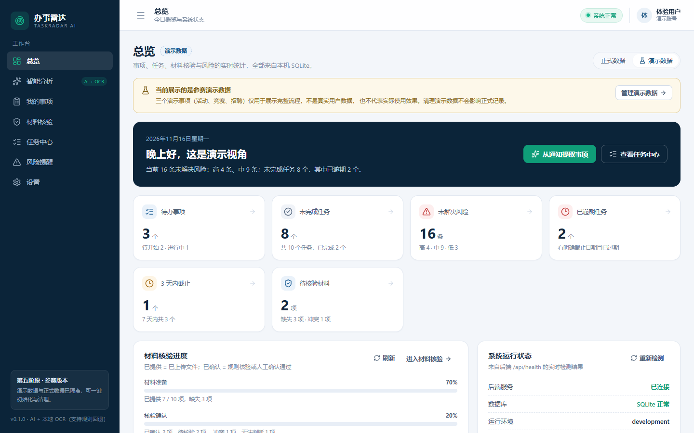
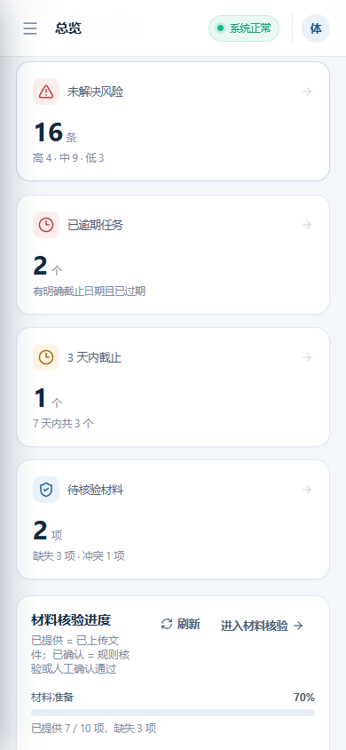
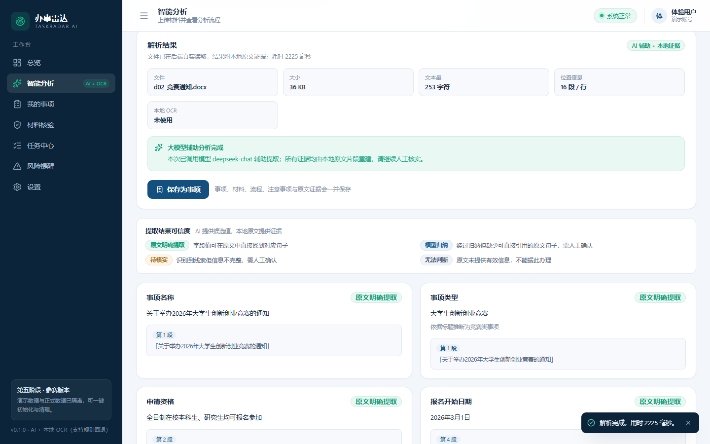
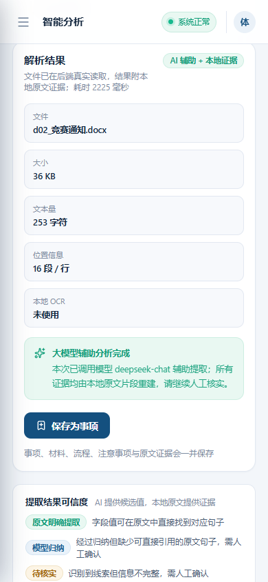
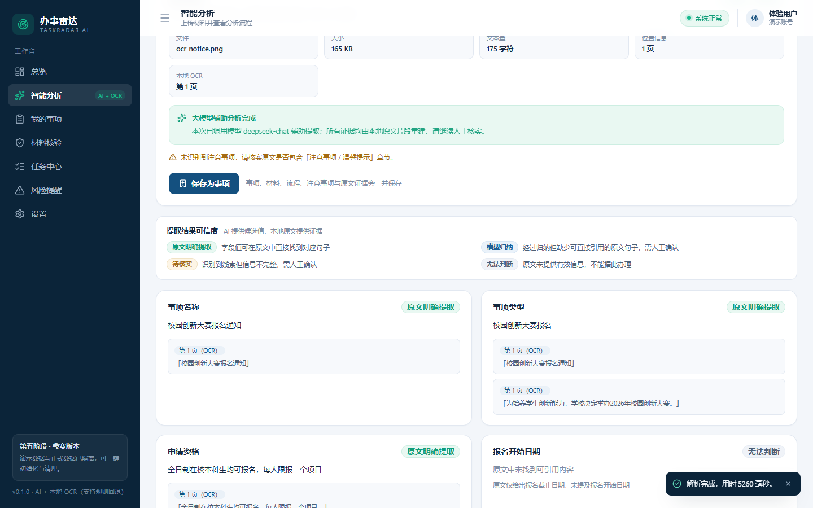
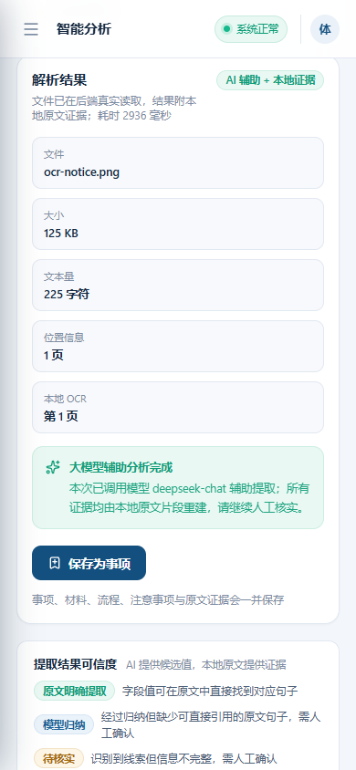
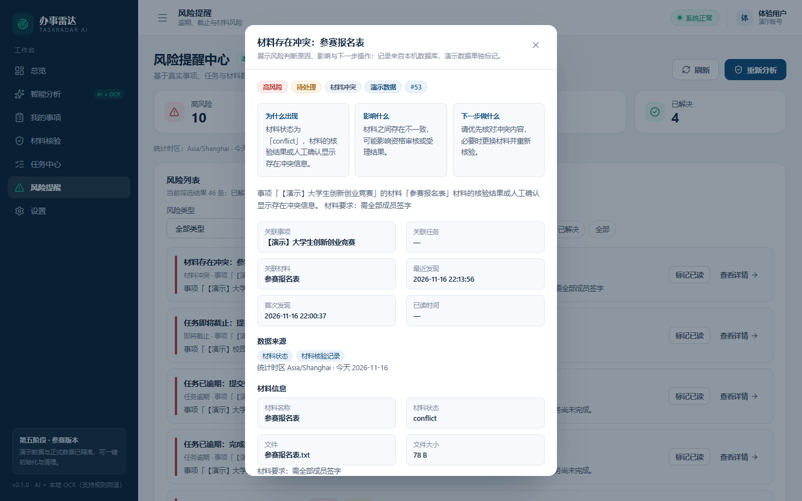
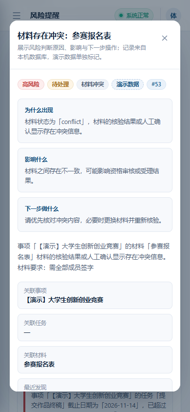
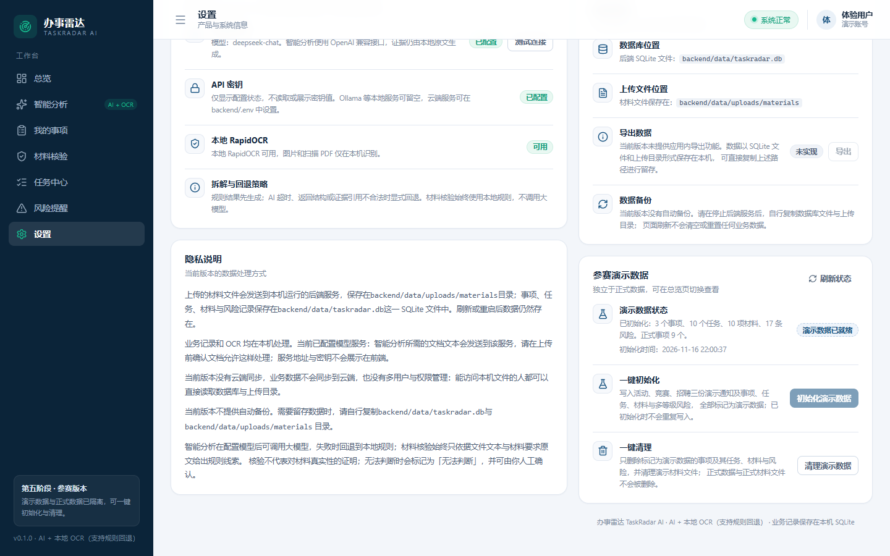
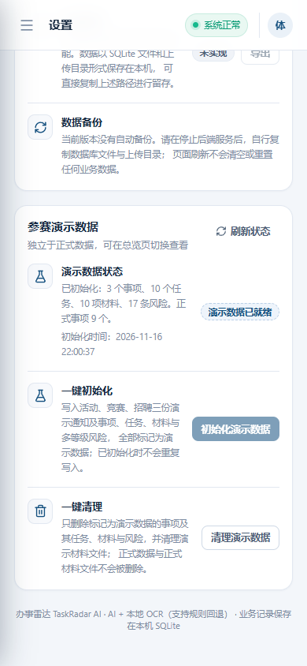

# 办事雷达 TaskRadar AI

> AI 智能事项拆解、本地 OCR 与材料规则核验平台 · TRAE 好应用大赏赛参赛项目

当前进度：**第五阶段 · 大模型接入与本地 OCR**。版本 `0.1.0`，前端阶段标识为「AI + 本地 OCR（支持规则回退）」，数据库 `schema_version = 6`。系统已支持 OpenAI 兼容大模型分析、本地 RapidOCR 图片与扫描 PDF 识别、总览真实统计以及演示数据隔离；材料核验仍使用本地规则，不调用大模型。

---

## 一、技术栈

| 层级 | 技术 |
| --- | --- |
| 前端 | React 18 + TypeScript + Vite 5 |
| 后端 | Python 3.11 + FastAPI + Uvicorn |
| 数据库 | SQLite（Python 标准库 `sqlite3`，无需额外安装） |
| 大模型 | OpenAI Python SDK，调用 OpenAI 兼容 `chat/completions` 接口 |
| OCR | RapidOCR + ONNX Runtime，本地推理 |
| 文档解析 | PyMuPDF（PDF）、python-docx（DOCX）、Pillow（图片） |

---

## 二、目录结构

> 后端 `app/` 与前端 `src/` 为完整文件清单，其余目录只列出主要文件。

```
TaskRadar/
├─ backend/
│  ├─ app/
│  │  ├─ __init__.py
│  │  ├─ main.py                     FastAPI 入口（注册路由、CORS、启动时初始化数据库）
│  │  ├─ api/
│  │  │  ├─ __init__.py
│  │  │  └─ routes/
│  │  │     ├─ __init__.py
│  │  │     ├─ analysis.py           智能分析、能力状态、模型连接测试
│  │  │     ├─ dashboard.py          总览统计
│  │  │     ├─ demo.py               演示数据状态、初始化、清理
│  │  │     ├─ health.py             健康检查
│  │  │     ├─ materials.py          材料生成、上传、核验、确认
│  │  │     ├─ matters.py            事项接口
│  │  │     ├─ risks.py              风险提醒接口
│  │  │     └─ tasks.py              任务接口
│  │  ├─ core/
│  │  │  ├─ __init__.py
│  │  │  └─ config.py                读取 .env 的配置中心
│  │  ├─ db/
│  │  │  ├─ __init__.py
│  │  │  ├─ backup.py                 SQLite Backup API 备份（兼容 WAL）
│  │  │  ├─ dashboard.py             总览统计 SQL 聚合
│  │  │  ├─ database.py              建表、迁移、备份与连通性检查
│  │  │  ├─ materials.py             材料与操作记录读写
│  │  │  ├─ matters.py               事项读写
│  │  │  ├─ risks.py                 风险读写
│  │  │  └─ tasks.py                 任务读写
│  │  ├─ schemas/
│  │  │  ├─ __init__.py
│  │  │  ├─ analysis.py              分析、能力、连接测试响应模型
│  │  │  ├─ dashboard.py             总览与演示数据模型
│  │  │  ├─ material.py              材料模型
│  │  │  ├─ matter.py                事项模型
│  │  │  ├─ risk.py                  风险模型
│  │  │  └─ task.py                  任务模型
│  │  └─ services/
│  │     ├─ __init__.py
│  │     ├─ ai/
│  │     │  ├─ __init__.py
│  │     │  ├─ analyzer.py           严格 JSON 校验与本地证据重建
│  │     │  └─ client.py             OpenAI 兼容客户端与安全错误
│  │     ├─ demo/
│  │     │  ├─ __init__.py
│  │     │  └─ seed.py               演示数据初始化与清理
│  │     ├─ documents/
│  │     │  ├─ __init__.py
│  │     │  ├─ docx_reader.py        DOCX 读取
│  │     │  ├─ errors.py             文档错误类型
│  │     │  ├─ image_reader.py       PNG / JPG / JPEG 校验与 OCR
│  │     │  ├─ ocr_engine.py         RapidOCR 懒加载与推理
│  │     │  ├─ pdf_reader.py         PDF 原生文本与扫描页 OCR
│  │     │  ├─ reader.py             按扩展名分发
│  │     │  ├─ txt_reader.py         TXT 多编码读取
│  │     │  ├─ types.py              ExtractedDocument / Segment
│  │     │  └─ validators.py         格式、大小与资源上限校验
│  │     ├─ extraction/
│  │     │  ├─ __init__.py
│  │     │  ├─ extractor.py          字段、材料、流程、注意事项提取
│  │     │  └─ sections.py           章节与落款识别
│  │     ├─ materials/
│  │     │  ├─ __init__.py
│  │     │  ├─ generator.py          材料清单生成
│  │     │  ├─ storage.py            受控文件存储
│  │     │  └─ verifier.py           本地规则核验
│  │     ├─ risks/
│  │     │  ├─ __init__.py
│  │     │  ├─ analyzer.py           风险候选计算
│  │     │  ├─ dates.py              日期解析与业务时区
│  │     │  └─ service.py            风险刷新与同步
│  │     └─ tasks/
│  │        ├─ __init__.py
│  │        └─ generator.py          流程步骤生成任务
│  ├─ tests/
│  │  ├─ test_p1_fixes.py
│  │  ├─ test_p2_fixes.py
│  │  ├─ test_p3_fixes.py
│  │  ├─ test_p3_quality.py
│  │  └─ test_p4_ai_ocr.py
│  ├─ requirements.txt
│  ├─ .env.example
│  └─ data/                          SQLite 数据库与上传目录（首次启动自动生成）
│
├─ frontend/
│  ├─ src/
│  │  ├─ App.tsx
│  │  ├─ main.tsx
│  │  ├─ styles.css
│  │  ├─ types.ts
│  │  ├─ vite-env.d.ts
│  │  ├─ api/
│  │  │  ├─ analysis.ts
│  │  │  ├─ client.ts
│  │  │  ├─ dashboard.ts
│  │  │  ├─ demo.ts
│  │  │  ├─ materials.ts
│  │  │  ├─ matters.ts
│  │  │  ├─ risks.ts
│  │  │  └─ tasks.ts
│  │  ├─ components/
│  │  │  ├─ analysis/
│  │  │  │  ├─ AnalysisResultView.tsx
│  │  │  │  ├─ EvidenceList.tsx
│  │  │  │  └─ FieldCard.tsx
│  │  │  ├─ layout/
│  │  │  │  ├─ AppLayout.tsx
│  │  │  │  ├─ Sidebar.tsx
│  │  │  │  └─ Topbar.tsx
│  │  │  └─ ui/
│  │  │     ├─ Badge.tsx
│  │  │     ├─ Button.tsx
│  │  │     ├─ Card.tsx
│  │  │     ├─ FileDropzone.tsx
│  │  │     ├─ Modal.tsx
│  │  │     ├─ PageHeader.tsx
│  │  │     └─ Toast.tsx
│  │  ├─ config/navigation.ts        7 个导航入口
│  │  ├─ hooks/
│  │  │  ├─ useHashRoute.ts
│  │  │  └─ useSystemHealth.tsx
│  │  ├─ lib/
│  │  │  ├─ format.ts
│  │  │  ├─ meta.ts
│  │  │  └─ version.ts
│  │  └─ pages/
│  │     ├─ AnalyzePage.tsx
│  │     ├─ DashboardPage.tsx
│  │     ├─ MattersPage.tsx
│  │     ├─ RisksPage.tsx
│  │     ├─ SettingsPage.tsx
│  │     ├─ TasksPage.tsx
│  │     └─ VerificationPage.tsx
│  ├─ public/favicon.svg
│  ├─ index.html
│  ├─ vite.config.ts                 /api 代理到后端
│  ├─ package.json
│  ├─ tsconfig.json
│  └─ .env.example
│
├─ docs/screenshots/                 界面预览截图（1440×900 / 390×844）
├─ e2e_tests/                        端到端测试报告与证据
├─ start.bat                         一键启动后端与前端
├─ stop.bat                          按端口停止本项目进程
├─ .gitignore
└─ README.md
```

---

## 三、启动前准备

| 软件 | 要求 | 检查命令 |
| --- | --- | --- |
| Python | 3.11 及以上 | `py -3.11 --version` |
| Node.js | 18 及以上 | `node --version` |
| npm | 随 Node 安装 | `npm --version` |

> Windows 提示：如果 `python` 命令报错或提示缺少 pip，请统一改用 `py -3.11`。

---

## 四、一键启动（推荐）

在项目根目录**双击 `start.bat`**。脚本会检查虚拟环境、前端依赖与 `backend\.env`，确认端口可用后，在独立窗口分别启动后端与前端；后端健康检查通过后自动打开浏览器，并在启动器窗口打印后端地址、前端地址与停止方式。停止时双击 `stop.bat`。

端口规则：

- 后端固定使用 `8000`。端口被占用时直接给出中文提示并退出，不会结束其他进程。
- 前端优先 `5173`；被占用时自动改用 `5174`，仍被占用则使用 `5175`。
- 端口回落不影响接口调用：`start.bat` 会用实际前端端口设置环境变量 `CORS_ORIGINS` 再启动后端；`backend` 的默认允许来源也已包含 `5174`、`5175`。若改为前后端直连（非 `/api` 代理），需同步 `CORS_ORIGINS`，把前端实际地址加入 `backend\.env`。
- 实际使用的端口写入 `.run\ports.txt`（格式为 `BACKEND=8000`、`FRONTEND=5174`），该目录已加入 `.gitignore`。
- `stop.bat` 读取该文件，先列出将结束的端口、PID 与进程名，输入 `Y` 确认后才执行 `taskkill /PID /T /F`；不会按 `uvicorn` / `node` 进程名批量结束。端口已空闲时会提示「已空闲」。若 `.run\ports.txt` 不存在（例如服务不是通过 `start.bat` 启动的），脚本只给出提示并退出，**不会按默认端口猜测并结束进程**，避免误杀其他项目。

启动失败排查顺序：`backend\.venv\Scripts\python.exe` → `frontend\node_modules` → `backend\.env`（从 `.env.example` 复制，且不要提交）→ `8000` 是否被占用 → 查看标题为「TaskRadar 后端」的窗口报错。脚本不会读取、输出或回显 `.env` 内容与密钥。

下方第五、六节保留原手动启动步骤，供调试或单独重启某一端时使用。

## 五、启动后端（手动，备选）

在项目根目录打开 PowerShell：

```powershell
cd backend
py -3.11 -m venv .venv
.\.venv\Scripts\Activate.ps1
pip install -r requirements.txt
Copy-Item .env.example .env
py -3.11 -m uvicorn app.main:app --reload --port 8000
```

看到下面这一行表示启动成功：

```
Uvicorn running on http://127.0.0.1:8000
```

> 如果激活虚拟环境时提示「禁止运行脚本」，执行一次
> `Set-ExecutionPolicy -Scope CurrentUser RemoteSigned`，然后重新激活。

首次安装会下载 ONNX Runtime 与 OCR 模型依赖，体积较大；OCR 模型在第一次识别时才加载，不会拖慢普通启动。

---

## 六、启动前端（手动，备选）

```powershell
cd frontend
npm install
Copy-Item .env.example .env.local
npm run dev
```

看到下面这一行表示启动成功：

```
Local:   http://127.0.0.1:5173/
```

浏览器打开 <http://127.0.0.1:5173> 即可。

### 远程演示（公网临时访问）

`npm run dev` 的 dev server 仅供开发；公网演示使用构建产物，避免暴露源码与热更新连接。

```powershell
cd frontend
npm run build
npm run demo:preview
```

`demo:preview` 等价于 `vite preview --host 0.0.0.0 --port 5174 --strictPort`，由 `dist/` 提供服务，并复用 `server.proxy` 把 `/api` 转发到 `http://127.0.0.1:8000`。`vite.config.ts` 已把 `.trycloudflare.com` 写入 `server.allowedHosts` 与 `preview.allowedHosts`，隧道域名无需临时配置即可访问。

需要公网访问时，另开终端建隧道（只隧道前端端口，不要隧道 8000）：

```powershell
cloudflared tunnel --url http://127.0.0.1:5174
```

终端会输出 `https://<随机子域名>.trycloudflare.com`。该地址对任何拿到链接的人公开，系统当前无鉴权；演示结束按 `Ctrl+C` 关闭隧道，链接立即失效。

> 临时隧道地址不要写进 README，也不要提交，避免评委点到死链。

---

## 七、如何判断项目已成功运行

1. **后端**：访问 <http://127.0.0.1:8000/api/health>，返回类似：

   ```json
   {
     "status": "ok",
     "app": "办事雷达 TaskRadar AI",
     "version": "0.1.0",
     "environment": "development",
     "database": "ok",
     "time": "2026-11-16T10:00:00"
   }
   ```

   `status` 与 `database` 均为 `ok` 即代表后端与数据库正常。

2. **能力状态**：访问 <http://127.0.0.1:8000/api/analysis/capabilities>，可以看到 `analysis_mode`、`ai_configured`、`ai_model`、`ai_key_configured`、`ocr_enabled`、`ocr_available`、支持格式与大小上限。

3. **接口文档**：访问 <http://127.0.0.1:8000/docs> 可查看并在线调试全部接口。

4. **前端**：打开 <http://127.0.0.1:5173>，左侧显示七个导航入口，顶栏右侧状态为绿色「系统正常」，默认进入「总览」。若本机 5173 已被其他项目占用，启动器会回落到 5174 或 5175，以启动器打印的地址为准。

5. **数据库**：后端首次启动后自动生成 `backend/data/taskradar.db`。

6. **首次启动是空库**：新建的数据库没有任何事项、任务、材料与风险，总览会显示 0。需要看完整效果时，进入「设置 → 参赛演示数据」点击「初始化演示数据」，即可写入 3 个演示事项及其任务、材料、风险；演示数据与正式数据隔离，可随时一键清理。这一步只在首次查看时要做一次，之后数据会持久保存在 SQLite 中。

---

## 八、常用地址

| 用途 | 地址 |
| --- | --- |
| 前端页面 | <http://127.0.0.1:5173>（5173 被占用时为 5174 / 5175） |
| 后端服务 | <http://127.0.0.1:8000> |
| 健康检查 | <http://127.0.0.1:8000/api/health> |
| 分析能力 | <http://127.0.0.1:8000/api/analysis/capabilities> |
| 总览统计 | <http://127.0.0.1:8000/api/dashboard/summary> |
| 接口文档 | <http://127.0.0.1:8000/docs> |

---

## 九、页面与交互

左侧导航由 `frontend/src/config/navigation.ts` 定义，共 **7 个入口**；地址栏 hash 会同步变化，支持浏览器前进 / 后退。

| 页面 | 地址 | 内容 |
| --- | --- | --- |
| 总览 | `#/dashboard` | 正式 / 演示数据范围切换、统计卡片、材料进度、近期截止、最近事项、系统状态 |
| 智能分析 | `#/analyze` | 上传文档或图片、解析进度、要素结果、原文证据、AI / 规则三态说明 |
| 我的事项 | `#/matters` | 搜索、状态与类型筛选、新建事项、详情弹窗、演示数据标记 |
| 材料核验 | `#/verification` | 材料清单、六种状态、逐项上传、规则核验、人工确认、操作记录 |
| 任务中心 | `#/tasks` | 状态分组、优先级筛选、编辑、完成、删除、手动新增 |
| 风险提醒 | `#/risks` | 等级汇总、类型与状态筛选、风险详情、标记已读、重新分析 |
| 设置 | `#/settings` | 产品信息、AI 与 OCR 状态、模型连接测试、演示数据管理、隐私说明 |

主要交互：

- 窄屏下侧边导航收纳为抽屉，可打开 / 关闭。
- 智能分析支持拖拽 / 点击选择单个文件，前端预校验扩展名与 10MB 上限，使用 XMLHttpRequest 展示上传进度。
- 分析结果页可一键「保存为事项」，并跳转到我的事项。
- 事项详情可生成任务与材料清单；任务与材料操作全部读写真实接口。
- 风险详情提供跳转关联事项、任务、材料的入口。
- 所有提示统一使用右下角轻提示（Toast）。

---

## 十、界面预览

以下截图均由本机 Edge 无头浏览器直接拍摄真实运行界面，视口分别为 **1440×900** 与 **390×844**，数据来自本机 SQLite，未使用设计稿、示意图或占位图。拍摄时逐张检查 `document.documentElement.scrollWidth` 与视口宽度一致、控制台 0 报错，画面不包含密钥、服务地址、本地绝对路径或浏览器书签栏。

### 总览：高风险、逾期任务与材料冲突同屏

**桌面 1440×900**



这张图证明：切到「演示数据」后，总览由真实 SQL 聚合同时给出 16 条未解决风险（其中高 4 条）、2 个已逾期任务与 1 项材料冲突，并明确标注这是与正式数据隔离的演示视角。

**移动 390×844**



这张图证明：390px 下统计卡片纵向重排后，未解决风险（高 4）、已逾期任务（2 个）与材料冲突（1 项）仍在同一屏内完整呈现，且没有横向溢出。

### 智能分析：`ai_assisted` 徽标与本地原文证据

**桌面 1440×900**



这张图证明：真实上传 `d02_竞赛通知.docx` 后返回 `ai_assisted`（界面显示「AI 辅助 + 本地证据」），模型只提供候选值，证据位置与原文摘录由后端按本地片段重建（如图中的第 1 段、第 10 段）。

**移动 390×844**



这张图证明：移动端结果页保留同一个 AI 徽标、真实耗时、文件大小与文本量，并在下方继续展示「提取结果可信度」分级，布局自适应而非裁剪。

### OCR：`ocr_used` 与「第 N 页（OCR）」

**桌面 1440×900**



这张图证明：上传中文 PNG 后由本机 RapidOCR 识别，结果区明确显示「本地 OCR：第 1 页」，字段证据位置为「第 1 页（OCR）」，说明文字确实来自图片 OCR 而非文件名或占位内容。

**移动 390×844**



这张图证明：移动端同样展示 OCR 页数、文本量、解析耗时与 AI 辅助说明，可在窄屏直接确认本次分析确实使用了本地 OCR。

### 风险详情：为什么出现 / 影响什么 / 下一步做什么

**桌面 1440×900**



这张图证明：风险详情把「为什么出现」「影响什么」「下一步做什么」三段判断、触发规则、数据来源与关联材料放在同一视图，且该条演示风险被单独标记。

**移动 390×844**



这张图证明：窄屏下三段说明改为纵向排列后仍完整可见，不依赖横向滚动或悬浮提示。

### 设置：演示数据管理

**桌面 1440×900**



这张图证明：设置页读取后端真实状态，显示演示数据已初始化的 3 个事项、10 个任务、10 项材料、17 条风险与正式事项 9 个，并提供初始化与清理入口。

**移动 390×844**



这张图证明：移动端仍能查看演示数据状态、初始化时间与「清理演示数据」入口，说明该管理能力并非只在桌面端可用。

---

## 十一、文档读取与本地 OCR

### 支持的格式

| 格式 | 读取方式 | 证据位置 |
| --- | --- | --- |
| PDF（含文本层） | PyMuPDF 逐页读取原生文本 | 第 N 页 |
| PDF（扫描页 / 低文本页） | 本机 RapidOCR 识别页面图像 | 第 N 页（OCR） |
| PNG / JPG / JPEG | Pillow 校验后本机 RapidOCR 识别 | 第 1 页（OCR） |
| DOCX | python-docx 读取段落与表格 | 第 N 段 / 表格 N 第 M 行 |
| TXT | 自动识别 UTF-8 / GB18030 / UTF-16 | 第 N 行 |

### OCR 行为边界

- 使用 RapidOCR + ONNX Runtime 在本机推理，图片与扫描件不会上传到第三方 OCR 服务。
- 图片按真实文件格式校验，而不只看扩展名；`.jpg` 与 `.jpeg` 都要求内容为 JPEG，`.png` 要求内容为 PNG。
- 读取时处理 EXIF 方向，避免手机照片横竖颠倒。
- 单张图片像素上限由 `OCR_MAX_IMAGE_PIXELS` 控制，默认 20,000,000；超限返回 413。
- PDF 页优先读取原生文本。整份 PDF 没有任何原生文本时，所有页面都作为 OCR 候选；存在原生文本时，只有非空白字符少于 `OCR_PDF_TEXT_THRESHOLD`（默认 20）且该页含图片的页面才执行 OCR。
- 单份 PDF 需要 OCR 的页数超过 `OCR_MAX_PAGES`（默认 50）时拒绝处理，并提示拆分文档。
- 页面按 `OCR_PDF_DPI`（默认 200）渲染；渲染后像素超过上限时提示降低 DPI 或拆分页面。
- 图片短边低于 `OCR_MIN_IMAGE_SIDE`（默认 1200）或总像素低于 `OCR_MIN_IMAGE_PIXELS`（默认 1,500,000）时，在 `warnings` 中提示分辨率偏低，**不拒绝识别**；该阈值是 DPI 的近似替代，用于覆盖 1440×900 / 1920×1080 屏幕截图，A4 @150DPI（1240×1754）不会触发。
- 识别结果按 `OCR_MIN_CONFIDENCE`（默认 0.5）过滤低置信度文本。
- 部分页 OCR 失败但仍有原生文本时，保留已获得的内容，并在 `warnings` 中逐页说明；整份文档没有任何可用文本时才返回错误。
- OCR 只产出统一的 `Segment`，后续规则提取、大模型分析与材料核验链路完全复用，不需要单独分支。
- 关闭 `OCR_ENABLED` 后，纯图片或纯扫描 PDF 返回明确错误；混合 PDF 会保留原生文本并给出警告。

### OCR 配置项

以下变量均可在 `backend/.env` 中设置，示例见 `backend/.env.example`。

| 变量 | 默认值 | 说明 |
| --- | --- | --- |
| `OCR_ENABLED` | `true` | 本地 OCR 总开关 |
| `OCR_MAX_PAGES` | `50` | 单份 PDF 允许执行 OCR 的最大页数 |
| `OCR_PDF_DPI` | `200` | 扫描页渲染 DPI |
| `OCR_PDF_TEXT_THRESHOLD` | `20` | 页面原生文本少于该字符数时视为低文本页 |
| `OCR_MAX_IMAGE_PIXELS` | `20000000` | 单张图片或单页渲染的像素上限 |
| `OCR_MIN_IMAGE_SIDE` | `1200` | 图片短边低于该值时提示分辨率偏低（只提示，不拒绝） |
| `OCR_MIN_IMAGE_PIXELS` | `1500000` | 图片总像素低于该值时提示分辨率偏低（只提示，不拒绝） |
| `OCR_MIN_CONFIDENCE` | `0.5` | 低于该置信度的识别结果被丢弃 |

### 资源上限

| 项目 | 上限 |
| --- | --- |
| 单文件大小 | 10MB（`MAX_UPLOAD_MB`） |
| PDF 页数 | 500 页 |
| DOCX 解压后大小 | 100MB，且压缩比不超过 100 |
| 文档提取文本总长度 | 2,000,000 字符 |
| 单份 PDF 的 OCR 页数 | 50 页 |
| 单张图片 / 单页渲染像素 | 20,000,000 |

错误码包括 `unsupported_format`、`empty_file`、`file_too_large`、`invalid_document`、`encrypted_pdf`、`invalid_image`、`image_extension_mismatch`、`image_too_large`、`no_text`、`ocr_disabled`、`ocr_unavailable`、`ocr_failed`、`ocr_too_many_pages`、`text_too_large`。

---

## 十二、规则提取（始终先生成）

无论是否配置大模型，后端都会先用本地规则提取一遍，作为可靠结果与 AI 失败时的回退。

- 固定提取五个字段：事项名称、事项类型、申请资格、报名开始日期、截止日期。
- 同时提取所需材料、办理流程、注意事项，并为每条结果附原文片段与位置。
- 章节识别覆盖通知、赛事、招聘等常见标题：参赛对象 / 参与对象 / 报名方式 / 报名时间 / 注意事项 / 联系方式 / 主办单位 / 附件；表格中的「标题 | 正文」也能识别。
- 支持从普通正文提取材料要求（如「填写报名表」「将作品发送至邮箱」），以及从报名方式、申请方式、办理方式等章节提取办理步骤。
- 日期支持区间识别（如「2026年11月13日至2026年11月20日」），在同段或前文存在明确年份时补全，并在备注中说明依据；多个不同截止日期会写入备注提示冲突。
- 注意事项会过滤联系人、电话、邮箱、主办 / 承办单位、附件标题与落款，避免元信息混入。
- 未找到原文依据的字段 `status` 为 `pending`，前端显示「待核实」，不做编造。

---

## 十三、大模型接入

### 配置即启用

- 使用 OpenAI Python SDK 调用 OpenAI 兼容 `chat/completions` 接口，支持云端兼容服务，也支持无密钥的本地 Ollama。
- 只要 `AI_BASE_URL` 与 `AI_MODEL` 都非空，即视为已配置；`AI_API_KEY` 可以为空。
- 无密钥时客户端不会发送伪造的 `Authorization` 头。
- 密钥只从 `backend/.env` 或环境变量读取，不写入 SQLite、不进入接口响应、不进入前端状态；`GET /api/analysis/capabilities` 只返回 `ai_key_configured` 布尔值。
- 日志只记录异常类型，不记录密钥、提示词或文档内容。

### 三种分析模式

| `analysis_mode` | 含义 |
| --- | --- |
| `rule_based` | 未配置 `AI_BASE_URL` / `AI_MODEL`，只返回本地规则结果 |
| `ai_assisted` | 模型返回通过全部校验，返回 AI 结果，证据由本地原文重建 |
| `rule_fallback` | 已配置模型但调用失败或结果不合法，明确回退到本地规则结果 |

前端会按模式显示不同徽标与说明，`rule_fallback` 不会伪装成 AI 成功，并展示回退原因。

### 调用与校验流程

1. 文档读取完成（必要时先做本地 OCR），得到本地 `Segment` 列表。
2. 在线程池中执行规则提取，先得到可用的规则结果。
3. 未配置模型时直接返回 `rule_based`。
4. 已配置模型时，把带编号的原文片段发送给模型，要求返回严格 JSON。
5. 模型只能返回候选值与 `segment_id`，不得返回证据正文、页码、段落或位置。
6. 后端按 `segment_id` 从本地 `Segment` 重建证据，页码、段落、位置全部以本地为准。
7. 任一校验失败，整份 AI 结果作废，回退为 `rule_fallback`。

### JSON 约束与失败条件

- 根节点必须是 JSON 对象；仅保守剥离一层 Markdown JSON 代码围栏。
- `fields` 必须且只能包含五个字段，键与顺序固定为 `title`、`matter_type`、`qualification`、`registration_start`、`deadline`。
- `found` 字段必须有非空值和非空证据编号；`pending` 字段不能有值或证据编号。
- `materials` / `process` / `notes` 每项必须引用一个合法 `segment_id`。
- 内部模型禁止额外字段；材料最多 40 项、流程最多 30 项、注意事项最多 20 项，单字段证据编号最多 5 个。
- `segment_id` 为负数或越界、字段键或顺序错误、缺少证据、JSON 结构非法，均使整份 AI 结果无效。
- 文档文本总字符数超过 `AI_MAX_INPUT_CHARS`（默认 60,000）时直接报错，**不截断发送**，随后回退到规则结果。
- 请求参数固定 `temperature = 0`，分析 `max_tokens = 4096`；超时由 `AI_TIMEOUT_SECONDS` 控制，重试次数被限制在 0–1 次。
- 超时、鉴权失败、限流、连接失败、HTTP 状态错误都会转换为安全中文提示。

### 连接测试

`POST /api/analysis/ai/test` 只发送一条短提示「只回复 OK」，`max_tokens = 8`，**不发送任何文档内容**。成功与失败均返回结构化结果，其中包含模型名与耗时，但不包含服务地址、密钥或原始异常。

### 配置项

以下变量均可在 `backend/.env` 中设置，示例见 `backend/.env.example`。

| 变量 | 默认值 | 说明 |
| --- | --- | --- |
| `AI_PROVIDER` | `OpenAI 兼容服务` | 仅用于前端展示的服务商名称 |
| `AI_API_KEY` | 空 | 云端服务密钥；本地 Ollama 可留空 |
| `AI_MODEL` | 空 | 模型名；与 `AI_BASE_URL` 同时非空才视为已配置 |
| `AI_BASE_URL` | 空 | OpenAI 兼容接口根地址 |
| `AI_TIMEOUT_SECONDS` | `60` | 单次请求超时秒数 |
| `AI_MAX_RETRIES` | `1` | 重试次数，实际限制在 0–1 |
| `AI_MAX_INPUT_CHARS` | `60000` | 单次分析允许发送的最大字符数，超限不截断 |

隐私边界：配置外部模型后，智能分析所需的文档文本会发送到该服务；OCR 与业务数据仍在本机。材料核验不调用大模型。

---

## 十四、总览统计与演示数据

### 总览统计

`GET /api/dashboard/summary?demo=false` 只读查询真实数据库并完成 SQL 聚合，不写入任何数据。

- `demo=false`（默认）只统计 `is_demo = 0` 的正式数据；`demo=true` 只统计 `is_demo = 1` 的演示数据。
- 返回事项总数与待办 / 进行中 / 已完成数量、任务总数与未完成 / 已完成 / 逾期 / 3 天内 / 7 天内数量、材料各状态数量与准备率 / 确认率、未解决风险的高 / 中 / 低数量。
- 返回最近更新的 5 个事项与最多 5 个近期截止任务（含已逾期与 7 天内截止，按剩余天数排序）。
- 返回 `scope`、`timezone`、`today`、`generated_at`，前后端以同一业务时区口径统计。

### 演示数据

演示数据与正式数据通过 `matters.is_demo` 严格隔离。

| 方法 | 地址 | 说明 |
| --- | --- | --- |
| GET | `/api/demo/status` | 演示与正式事项、任务、材料、风险数量及初始化时间 |
| POST | `/api/demo/seed` | 幂等初始化三份演示通知及其事项、任务、材料、风险；`?refresh=true` 时先清理再按当天重算日期 |
| DELETE | `/api/demo/clear` | 只删除 `is_demo = 1` 的事项，级联清理其任务、材料、风险，并删除上传根目录下的 `demo/` 子目录（默认 `data/uploads/materials/demo/`） |

- 初始化已存在时直接返回状态，不重复写入；响应中的 `refreshed` 表示本次是否清空重建。
- 演示截止日期在**初始化当天**按「今天 + 12 / 今天 − 2 / 今天 + 21 天」计算，之后会随时间漂移，导致任务逾期天数与风险条数变化。演示前请在「设置 → 参赛演示数据」点击「刷新演示数据」，或调用 `POST /api/demo/seed?refresh=true`，无需先清理再初始化。
- `refresh=true` 时删除旧演示数据、写入事项 / 任务 / 材料、计算并写入风险与历史状态全部在同一连接、同一事务内完成，整个刷新只提交一次：任一步失败都整体回滚，刷新前的旧演示数据原样保留，不会出现「旧数据已删、新数据又被清空」的空演示环境。
- 演示材料文件为可直接读取的 TXT，文件名取材料名，写入上传根目录下的 `demo/` 子目录，不进入正式材料的 `matter-<id>/` 目录。文件写入不在数据库事务内；刷新失败时会尽力清理本次新增且未被引用的文件，该保证为 best-effort：提交成功后清理不再被引用的历史文件，失败回滚后也会清理本次新增文件；清理自身出错只记录日志，不覆盖原始异常。
- 清理只删除 `demo/` 子目录，正式材料目录与 `is_demo = 0` 的数据不会被触碰。
- 演示数据不包含用户数量、节省时间、准确率等虚构指标。
- 演示风险条数由当前风险规则计算，不是固定值。

---

## 十五、数据库结构与迁移

当前 `SCHEMA_VERSION = 6`，连接开启 `PRAGMA foreign_keys = ON`。所有迁移均为增量操作，不删除、不重置已有数据。

| 表 | 用途 |
| --- | --- |
| `app_meta` | 保存 `schema_version` |
| `matters` | 事项及提取结果 |
| `tasks` | 事项下的任务 |
| `materials` | 材料清单、文件与核验结果 |
| `material_events` | 材料操作记录 |
| `risks` | 风险提醒与状态流转 |

### 迁移历史

| 版本 | 变更 |
| --- | --- |
| 1 → 2 | 新增 `matters` 表 |
| 2 → 3 | 新增 `tasks` 表及防重索引 |
| 3 → 4 | 新增 `materials` 与 `material_events` 表 |
| 4 → 5 | `matters` 新增 `deadline_source`；新增 `risks` 表 |
| 5 → 6 | `matters` 新增 `is_demo INTEGER NOT NULL DEFAULT 0` |

### 迁移安全

- 结构版本高于程序支持版本时拒绝启动，避免旧程序破坏新库。
- 需要迁移或补列时，先用 SQLite Backup API 在 `backend/data/migration_backups/` 生成副本，并执行 `PRAGMA integrity_check`；校验失败则中止迁移。
- 建表、补列、数据回填和版本号更新在同一写事务中完成，任一步失败整体回滚。
- 历史事项补 `deadline_source` 时，有来源文件的记为 `document`，手动创建的记为 `manual`；历史事项的 `is_demo` 一律为 `0`。

### 主要字段

`matters`：`id`、`name`、`matter_type`、`qualification`、`registration_start`、`deadline`、`deadline_source`、`materials_json`、`process_json`、`notes_json`、`fields_json`、`source_filename`、`status`、`analysis_mode`、`is_demo`、`created_at`、`updated_at`。

`tasks`：`matter_id`、`title`、`description`、`deadline`、`deadline_source`、`priority`、`status`、`source_evidence_json`、`step_key`、`origin`、`created_at`、`updated_at`；`(matter_id, step_key)` 使用部分唯一索引防止重复生成。

`materials`：`matter_id`、`name`、`description`、`status`、`file_path`、`original_filename`、`file_size`、`file_type`、`verification_result`、`verification_evidence_json`、`verified_at`、`source_evidence_json`、`step_key`、`origin`、`created_at`、`updated_at`。

`risks`：`fingerprint`（唯一）、`risk_type`、`risk_level`、`title`、`description`、`matter_id`、`task_id`、`material_id`、`evidence_json`、`suggestion`、`status`、`first_seen_at`、`last_seen_at`、`read_at`、`resolved_at`。

---

## 十六、接口总表

统一前缀为 `/api`，下表由各路由文件的实际装饰器整理，共 **36 个 `/api` 接口**。

此外服务还提供根路径 `GET /`（不在 `/api` 前缀下，定义在 `app/main.py`），返回服务名称、版本、文档地址与健康检查地址，因此 OpenAPI 文档中合计 **37 个操作**。

### 系统与总览

| 方法 | 路径 | 说明 |
| --- | --- | --- |
| GET | `/` | 服务信息 |
| GET | `/api/health` | 健康检查 |
| GET | `/api/dashboard/summary` | 总览统计，`demo` 可选 |
| GET | `/api/demo/status` | 查询演示数据状态 |
| POST | `/api/demo/seed` | 一键初始化演示数据；加 `?refresh=true` 时先清理并按当天重算日期 |
| DELETE | `/api/demo/clear` | 清理演示数据 |

### 智能分析

| 方法 | 路径 | 说明 |
| --- | --- | --- |
| GET | `/api/analysis/capabilities` | 分析能力与 AI / OCR 配置状态 |
| POST | `/api/analysis/ai/test` | 测试大模型连接，不发送文档 |
| POST | `/api/analysis/analyze` | 上传文档并执行 OCR / 规则 / AI 分析 |

### 事项

| 方法 | 路径 | 说明 |
| --- | --- | --- |
| POST | `/api/matters` | 创建并保存事项 |
| GET | `/api/matters` | 获取事项列表；支持 `limit`（1–500）与 `offset`（≥0），offset 可单独使用，缺省 limit 时返回 offset 之后的全部数据 |
| GET | `/api/matters/{matter_id}` | 获取事项详情 |
| PATCH | `/api/matters/{matter_id}` | 更新事项信息 |

### 任务

| 方法 | 路径 | 说明 |
| --- | --- | --- |
| POST | `/api/matters/{matter_id}/tasks` | 按事项办理流程生成任务 |
| POST | `/api/tasks` | 手动新增任务 |
| GET | `/api/tasks` | 查询任务列表；支持 `limit`（1–500）与 `offset`（≥0），offset 可单独使用，缺省 limit 时返回 offset 之后的全部数据 |
| GET | `/api/tasks/{task_id}` | 查询任务详情 |
| PATCH | `/api/tasks/{task_id}` | 修改任务 |
| DELETE | `/api/tasks/{task_id}` | 删除任务 |

### 材料

| 方法 | 路径 | 说明 |
| --- | --- | --- |
| POST | `/api/matters/{matter_id}/materials/generate` | 按事项材料要求生成材料清单 |
| GET | `/api/matters/{matter_id}/materials` | 查询事项的材料清单 |
| GET | `/api/matters/{matter_id}/materials/progress` | 查询事项材料准备进度 |
| POST | `/api/matters/{matter_id}/materials` | 手动新增材料 |
| GET | `/api/materials` | 查询材料列表；支持 `limit`（1–500）与 `offset`（≥0），offset 可单独使用，缺省 limit 时返回 offset 之后的全部数据 |
| GET | `/api/materials/{material_id}` | 查询材料详情 |
| PATCH | `/api/materials/{material_id}` | 修改材料名称与要求说明 |
| DELETE | `/api/materials/{material_id}` | 删除材料及其受控文件 |
| POST | `/api/materials/{material_id}/file` | 上传材料文件 |
| POST | `/api/materials/{material_id}/verify` | 执行规则核验 |
| POST | `/api/materials/{material_id}/confirm` | 人工确认或修改核验状态 |
| GET | `/api/materials/{material_id}/events` | 查询材料操作记录 |

### 风险

| 方法 | 路径 | 说明 |
| --- | --- | --- |
| GET | `/api/risks/summary` | 获取风险统计（只读） |
| POST | `/api/risks/refresh` | 主动重新分析风险 |
| GET | `/api/risks` | 查询风险提醒列表 |
| GET | `/api/risks/{risk_id}` | 查询风险详情 |
| PATCH | `/api/risks/{risk_id}/read` | 标记风险为已读 |
| GET | `/api/matters/{matter_id}/risks` | 查询事项关联风险与整体摘要（只读） |

材料上传与核验的格式说明：`/api/materials/{id}/file` 接受 PDF / DOCX / TXT / PNG / JPG / JPEG，字段名 `file`，上限 10MB。材料文件仍保存在受控目录，数据库只保存相对路径。核验结论仍由本地规则产生，来源标记为 `rule`，不代表材料真实性或法律效力。

---

## 十七、风险提醒规则

风险完全由本地规则计算，不调用大模型，也不做风险预测。

| `risk_type` | 等级 | 触发条件 |
| --- | --- | --- |
| `overdue` | high | 未完成任务，截止来源为 `document` / `manual`，且已过截止日 |
| `due_soon` | high / medium | 未完成任务剩余 0–3 天为 high，4–7 天为 medium |
| `backlog` | medium | 同一未完成事项存在 2 个及以上未完成任务 |
| `material_missing` | medium | 材料尚未提供 |
| `material_pending` | low | 材料已提供待核验 |
| `material_incomplete` | medium | 材料信息不完整 |
| `material_conflict` | high | 材料存在冲突 |
| `material_uncertain` | low | 材料无法判断 |
| `date_unverified` | low | 任务或事项截止日期无法解析 |

- 已完成事项与已完成任务不产生逾期、即将截止与积压提醒。
- 无截止日期或来源为 `none` 的任务不参与到期判断。
- 剩余天数大于 7 天不提醒。
- 风险以 `risk_type|matter:{id}|task:{id}|material:{id}` 作为稳定指纹幂等同步；重新出现时恢复为 `active`，已读状态保留。
- 本次未出现的活动风险会置为 `resolved` 并保留历史记录。

---

## 十八、材料核验边界

- 材料核验始终使用本地规则，不调用大模型。
- 检查项包括文件可读取、是否提取到有效文本、材料名称关键词覆盖、常见要素（签字 / 盖章 / 日期等）以及可疑表述。
- 规则只会给出 `qualified`（规则未发现问题）、`incomplete`（关键词或要素缺失）、`uncertain`（无文本、无可识别关键词或出现可疑表述）。
- `conflict` 只能由人工确认产生，规则不会自动判定材料无效。
- 文件名、上传成功、文件大小均不作为合格依据。
- 核验结论明确说明「不代表对材料真实性或法律效力的认定」。
- OCR 识别出的文本会正常进入上述规则核验，核验来源仍为 `rule`。

---

## 十九、备份与恢复

> **不要直接复制 `backend/data/taskradar.db`。** 数据库运行在 WAL 模式，最近已提交的写入可能只保存在 `taskradar.db-wal` 中，直接复制 `.db` 会静默丢失这部分数据。

1. 停止后端，避免备份过程中继续写入。
2. 用 SQLite Backup API 导出数据库（由引擎合并主库与 WAL，无需手工处理 `-wal` / `-shm`）：

   ```powershell
   cd backend
   .\.venv\Scripts\python.exe -c "from app.db.backup import backup_database; backup_database(r'D:\backup\taskradar.db')"
   ```

   也可以在自己的脚本中调用 `backup_database(target_path)` 或 `sqlite3.Connection.backup()`，效果相同。
3. 复制上传目录：`backend/data/uploads/`（保留 `materials/matter-{id}` 与 `demo` 子目录结构）。
4. 恢复时将备份数据库与上传目录放回原位，再启动后端。
5. `init_database()` 只做增量建表与迁移，不会覆盖已有记录。

迁移前自动备份位于 `backend/data/migration_backups/`，文件名包含原版本、目标版本与时间戳；该备份同样使用 Backup API。回退时可用备份覆盖当前数据库。

`.gitignore` 已忽略 `backend/data/` 与 `*.db` / `*.db-wal` / `*.db-shm`，WAL 临时文件不会被提交。

---

## 二十、已完成 / 未实现

**已完成**

- 前后端分离结构、FastAPI 健康检查、SQLite 初始化。
- 7 个页面、响应式布局、侧边导航与通用组件库。
- PDF / DOCX / TXT 真实读取，PNG / JPG / JPEG 本地 OCR，扫描与混合 PDF 页序合并。
- 事项五字段规则提取、材料 / 流程 / 注意事项提取、原文证据定位与「待核实」。
- `matters`、`tasks`、`materials`、`material_events`、`risks` 表与完整 CRUD。
- 流程一键生成任务（含防重与原文证据）、截止时间来源标记。
- 材料清单生成、文件上传、规则核验、人工确认、准备进度。
- 风险分析、刷新、已读、解决与恢复、事项整体风险摘要。
- OpenAI 兼容大模型分析与规则回退、连接测试。
- 总览真实统计、正式 / 演示数据隔离、演示数据一键初始化与清理。
- 数据库迁移前备份、事务化迁移与失败回滚。

**未实现**

- 用户注册 / 登录、多用户权限与登录鉴权。
- 多文件批量分析与结果合并。
- 数据导入 / 导出。
- 微信 / 短信 / 邮件推送、浏览器通知、日历同步。
- 风险预测与自动处理建议执行。
- 云端同步与后台定时任务。
- PDF / Word 原文高亮定位。
- 材料真实性或法律效力的自动判定。

---

## 二十一、测试记录

| 测试 | 日期 | 结果 | 来源 |
| --- | --- | --- | --- |
| 后端单元测试全量 | 2026-11-21 | 159 项通过 | 本次执行 `python -m unittest discover -s tests -v` |
| 其中 AI / OCR 专项 | 2026-11-16 | 25 项通过 | `backend/tests/test_p4_ai_ocr.py` |
| 前端类型检查与构建 | 2026-11-16 | 通过 | 本次执行 `npm run build`（`tsc --noEmit && vite build`，2131 个模块） |
| CI 与前端单元测试 | 2026-11-17 | 本地 `npm test` 14 项通过 | `.github/workflows/ci.yml` 两个并行 job：后端 Python 3.11 跑全量 unittest；前端 Node 18/20 矩阵执行 `npm ci`、`npm run build`、`npm test`。vitest 仅覆盖纯函数：`lib/format.ts` 的文件大小与日期时间格式化、`lib/meta.ts` 的状态文案与色调映射，含空值与异常输入。 |
| 真实场景端到端测试 | 2026-11-14 | 505 项检查，489 通过，8 失败后修复，8 项不适用 | `e2e_tests/E2E测试报告.md` |
| 390px 适配与交互 | 2026-11-15 | 11 个页面/弹窗无横向溢出、控制台 0 错误 | `e2e_tests/第五阶段第三步_UX打磨报告.md` |
| 界面预览截图 | 2026-11-16 | 10 张，`scrollWidth` 与视口一致、控制台 0 错误 | `docs/screenshots/` |

说明：

- 两份端到端报告均早于大模型与 OCR 接入，报告中「本地规则版」「未接入 OCR」等描述是当时状态，不代表当前版本。
- 真实 RapidOCR 冒烟已在本地用中文 PNG、JPG、扫描 PDF 各一份执行，均返回文本；该冒烟未纳入自动化测试，产物未留存。
- 真实大模型连接测试与一次合成中文通知分析已在本地配置 OpenAI 兼容服务后执行，分析模式为 `ai_assisted`；具体服务地址与密钥不写入本文档。

---

## 二十二、常见问题

**Q：顶栏显示「后端未连接」？**

A：先确认后端是否已在 8000 端口启动，再点击设置页的「重新检测」。

**Q：配置了模型但分析结果仍显示规则回退？**

A：查看分析结果中的回退原因。常见原因包括服务地址不可达、密钥错误、超时、返回不是合法 JSON、字段缺失或证据编号越界。回退不会影响规则结果。

**Q：本地 Ollama 需要填密钥吗？**

A：不需要。只需填写 `AI_BASE_URL` 与 `AI_MODEL`；无密钥时不会发送伪造的 `Authorization` 头。

**Q：如何关闭大模型，只用本地规则？**

A：清空 `backend/.env` 中的 `AI_BASE_URL` 或 `AI_MODEL`，重启后端即可。已配置的分析模式会回到 `rule_based`。

**Q：图片或扫描 PDF 识别失败？**

A：确认 `OCR_ENABLED=true`，并确认运行环境已安装 RapidOCR 与 ONNX Runtime 依赖。识别失败时可查看返回的具体错误码；部分页面失败但存在原生文本时，结果中会带 `warnings`。

**Q：为什么提示 OCR 页数过多？**

A：单份 PDF 需要 OCR 的页数超过 `OCR_MAX_PAGES`（默认 50）。请拆分文档，或适当调整该配置。

**Q：端口被占用？**

A：后端可换端口启动，例如 `py -3.11 -m uvicorn app.main:app --reload --port 8001`，同时修改 `frontend/vite.config.ts` 中 proxy 的 target 地址。

**Q：为什么要复制 `.env.example`？**

A：`.env.example` 只是示例模板，真实配置放在 `.env`（后端）和 `.env.local`（前端），这些文件不会提交到代码仓库。
